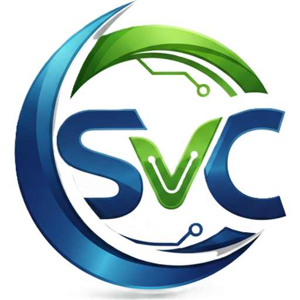
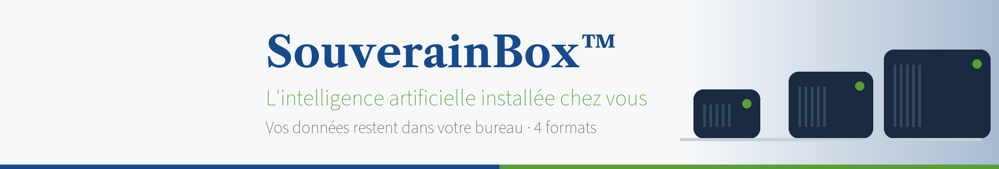
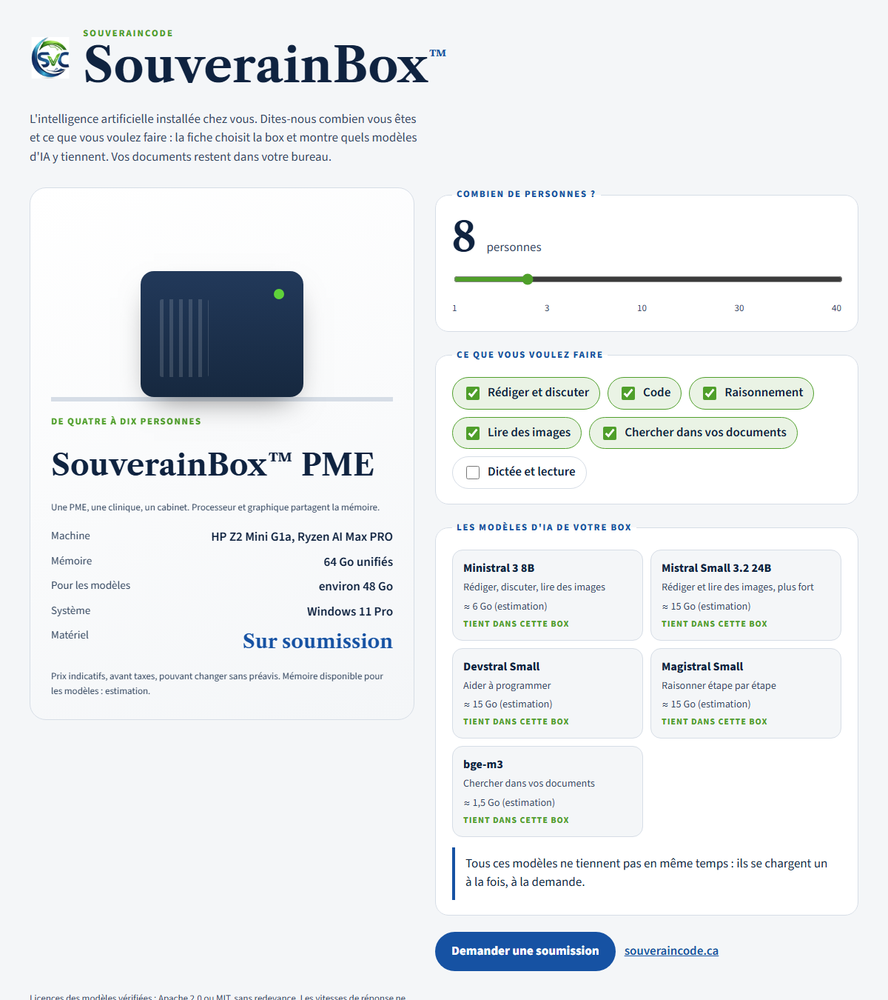
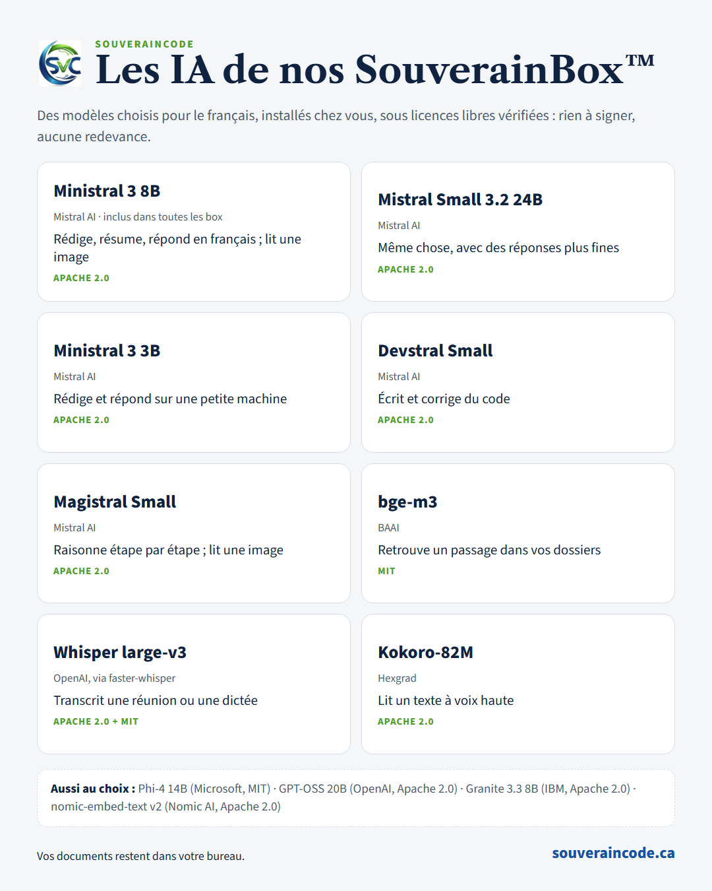

<h1 align="center">SouverainCode™</h1>

<b>Une IA d'ici, pour votre bureau.</b> · <i>Local AI for your office, made in Quebec.</i>

<a href="https://souveraincode.ca">souveraincode.ca</a> · <a href="https://archipelonline.com">archipelonline.com</a>

> Ce dépôt est une **vitrine**. Le code de SouverainCode est propriétaire et n'est pas publié ici.
> *This repository is a showcase. SouverainCode's source code is proprietary and not published here.*

## Ce que c'est

SouverainCode réunit trois espaces de travail dans un seul compte :

- **Talk** : posez vos questions, rédigez, résumez.
- **Dev** : un agent qui écrit et corrige du code.
- **Bureau** : documents et tableaux, prêts à envoyer.

SouverainCode choisit lui-même le bon modèle d'IA pour chaque demande. Il fonctionne sur notre serveur indépendant au Québec, ou **entièrement chez vous** avec une SouverainBox™.

## SouverainBox™ : l'IA installée chez vous

Quatre formats, de la **Solo** (une personne) à l'**Entreprise** (jusqu'à 30 personnes). Vos documents restent dans votre bureau.

## Les IA de nos SouverainBox™

Des modèles choisis pour le français, sous licences libres vérifiées (Apache 2.0 ou MIT).

## Pour qui

Cabinets d'avocats, études de notaires, cliniques, municipalités, PME, et toute organisation qui veut garder ses données chez elle.

## Démo et soumission

- Essai gratuit et soumission en ligne : **[souveraincode.ca](https://souveraincode.ca)**
- Nouveautés : **[archipelonline.com/nouveautes](https://archipelonline.com/nouveautes/)**

---

© 2026 Archipel. Tous droits réservés. SouverainCode™ et SouverainBox™ sont des marques d'Archipel.
*All rights reserved. No license is granted to use, copy or modify the content of this repository.*
